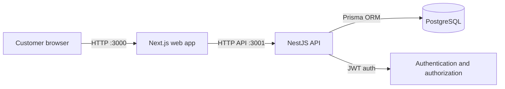

# System architecture

The web app is in `apps/web/`; the API and Prisma persistence layer are in `apps/api/`. End-to-end API tests are in `tests/api/`. Docker Compose builds both apps and keeps PostgreSQL data in the `db_data` named volume.
